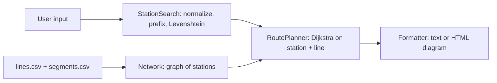

# ViennaRoute

Route planners usually hide how they work. ViennaRoute is a small command-line planner for the Vienna U-Bahn that shows the classic algorithm behind them: the network is a graph, the fastest trip is found with Dijkstra's algorithm, and changing lines has a cost.


## Quick start

```bash
cmake -S . -B build && cmake --build build
./build/viennaroute route hütteldorf seestadt --html route.html
```

```text
Hütteldorf -> Seestadt: 53 min, 1 transfer

  U4  Hütteldorf -> Schottenring  (15 stops, 24 min)
   change at Schottenring
  U2  Schottenring -> Seestadt  (14 stops, 25 min)

Riding 49 min + changing 4 min.
Saved diagram to route.html
```

Station names may be short, without umlauts or with typos: `karlspl`, `Laengenfeldgasse`, `Stefansplatz`. Ambiguous input gives suggestions:

```text
$ viennaroute route Schotten Oberlaa
'Schotten' is ambiguous. Did you mean:
  Schottenring
  Schottentor
```

Other commands: `viennaroute stations [filter]`, `viennaroute lines`, interactive mode without arguments, `--transfer N` to change the cost of a transfer.

## How it works



- **Graph.** Stations are nodes, rides between neighbouring stations are edges with minutes. Adjacency lists in `std::vector`.
- **Dijkstra on (station, line) states.** A plain station graph cannot see that changing lines takes time. With the line in the state, a transfer is an edge with its own cost (default 4 min). When two routes take the same time, the one with fewer transfers wins.
- **Fuzzy search.** Names are normalized (`Südtiroler Platz` → `suedtirolerplatz`), then matched exactly, by unique prefix, by substring, and finally by Levenshtein edit distance (about one typo per four letters).
- **HTML export** draws the route with the official line colours.

Complexity: O((V + E) log V) with `std::priority_queue`; the whole network (≈100 stations, 5 lines) is solved in microseconds.

## Data

`data/` contains lines U1, U2, U3, U4 and U6 with approximate travel times between stations, compiled by hand from public network maps. U2 is modelled in its current shape (Schottentor - Seestadt) while the U2/U5 construction is going on. To add a line, add a row to `lines.csv` and its segments to `segments.csv`.

## Tests

```bash
ctest --test-dir build --output-on-failure
```

18 GoogleTest tests: text normalization, Levenshtein distance, CSV loading and errors, fuzzy search, Dijkstra on a hand-made network where the transfer cost changes the answer, real routes across Vienna, text and HTML output.

## Run it in the browser

**Live: https://boris-plotnikov.click/viennaroute/** - plan a trip, try station names with typos and move the transfer cost to see Dijkstra change its mind.

The page runs this C++ code, not a JavaScript copy: the library is compiled to WebAssembly with Emscripten. `wasm/bindings.cpp` wraps Network, StationSearch, RoutePlanner and the formatter in a small `Planner` class; `web/` is a React page that calls it. The button **`</> Under the hood`** shows the C++ code behind every command, cut from the source at build time (`web/codetour.json`, `web/scripts/codetour.mjs`).

```bash
sh web/scripts/build-wasm.sh          # Emscripten in Docker -> web/src/wasm/
cd web && npm install && npm run build  # static page in web/dist
```

The web page was built by an external frontend developer to my specification and under my review; the C++ code and the bindings are mine.

## Tech stack

C++17 · STL (`priority_queue`, `map`, `optional`) · CMake · GoogleTest · GitHub Actions · Emscripten / WebAssembly

## About

Built by Boris Plotnikov as a portfolio project. Travel times are approximate; for real trips use the official Wiener Linien app.

AI tools were used to review code and speed up routine work. The design, the business rules and the tests are my own, and I can explain every part of the code.
